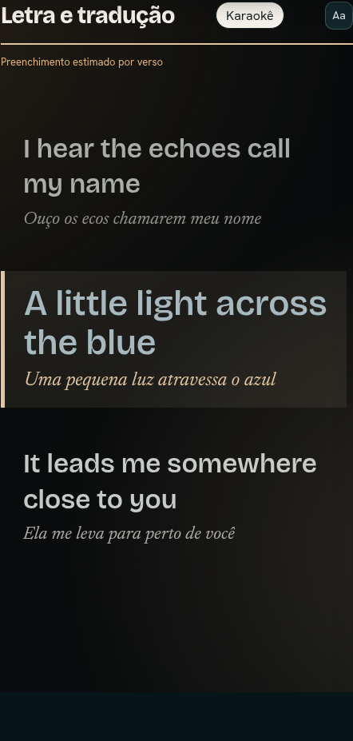

# Premium Motion Beta 0.1

Branch experimental `feat/gsap-premium-motion`, baseada em `86df57a`.

## O que mudou

- Os controles de transporte, favorito e letras respondem ao ponteiro e à ativação por teclado. Um listener por tipo de evento atende aos controles montados dinamicamente. A preferência de movimento reduzido desativa as microinterações.
- O botão **Karaokê** guarda a preferência no armazenamento local. A linha ativa acompanha a posição do áudio local, do Spotify ou do capítulo do YouTube. A marcação LRC por palavra define o início de cada trecho. Quando há apenas marcação por verso, a interface identifica a estimativa. Letras sem marcação continuam disponíveis com tradução.
- O player do YouTube usa a paleta da capa, exibe o canal e distingue carregamento, reprodução, pausa, buffering, encerramento, desconexão e falha de incorporação. A API oficial mantém controle do vídeo. Os controles personalizados ficam fora do iframe.

## Execução e avaliação

Com Node.js e npm instalados, execute na raiz:

```sh
git switch feat/gsap-premium-motion
npm ci
npm run dev
```

Abra a URL exibida pelo Vite. Associe um áudio local, habilite **Karaokê**, pause e clique em um verso. Experimente o controle de tamanho e recarregue para verificar a preferência. Cole um link de uma faixa individual do YouTube na busca para avaliar o player. Para Spotify, conecte a conta pelo fluxo existente. Com o ambiente Rust e os pré-requisitos do Tauri instalados, execute `npm run desktop:dev`.

## Validação

- TypeScript e build de produção executados com `npm run build`.
- Chromium com WAV local: reprodução, pausa, busca por verso, troca de faixa, ativação por teclado, tamanho da letra, preferência persistida e movimento reduzido. O botão também ficou acessível em viewport de 390 px.
- Chromium com API do YouTube simulada: play/pause, seek pausado, troca da linha ativa, buffering, término, incorporação bloqueada e fechamento. A troca para uma faixa Spotify simulada sem timestamps exibiu a letra tradicional. Nenhuma exceção JavaScript não tratada nesses fluxos.
- Parser exercitado com linhas fora de ordem, segundos inválidos, timestamps duplicados e palavras temporizadas.
- O projeto não define scripts de lint ou de testes. A reprodução autenticada no Spotify, o iframe real, a recuperação de uma desconexão real, leitores de tela e a execução nativa do Tauri ainda precisam de avaliação. Rust/Cargo indisponível neste ambiente.
- O HTML de referência aponta para imagens em uma pasta auxiliar ausente dos anexos. O acabamento segue a descrição do briefing e a paleta existente. A fidelidade à imagem do player aguarda comparação visual.

## Arquivos

| Arquivo | Alteração |
| --- | --- |
| index.html | Identificação da beta no título |
| src/App.tsx | Preferência, controles e sincronização local |
| src/Karaoke.tsx | Normalização LRC e preenchimento do verso |
| src/SpotifyLyrics.tsx | Integração com as letras remotas e fallback |
| src/YouTubePlayer.tsx | Estados, metadados e controles externos |
| src/useLyraMotion.ts | Microinterações e centralização |
| src/styles/immersive.css | Aparência, foco e movimento reduzido |
| previews/karaoke.png | Captura da seção de letras com áudio local |
| BETA_CHANGELOG.md | Resumo e roteiro de avaliação |



Para voltar à versão anterior no checkout, use `git switch main`. A integração da beta depende de aprovação visual e funcional.
